# punch-monkey-murders-tribe-escapes-zoo


**THE STORY FORGE** is a comprehensive, interactive story-development platform designed to manage the creative universe of *The Stuffed God of Monkey Mountain*.

It combines professional manuscript editing, character management, world-building, story planning, timeline visualization, scientific research organization, continuity tracking, and project analytics in one integrated application.

The platform provides a centralized workspace for managing an expansive fictional universe, maintaining narrative consistency, organizing complex character relationships, and developing long-form stories.

The application operates using a seeded mock-data architecture and browser-based persistence, allowing users to explore and manage the entire project without requiring an external database or third-party backend service.

---

# Table of Contents

1. [Project Overview](#1-project-overview)
2. [Project Objectives](#2-project-objectives)
3. [Core Features](#3-core-features)
4. [Technology Stack](#4-technology-stack)
5. [System Architecture](#5-system-architecture)
6. [Application Architecture](#6-application-architecture)
7. [Directory Structure](#7-directory-structure)
8. [Data Architecture](#8-data-architecture)
9. [Mock Data and Persistence](#9-mock-data-and-persistence)
10. [Manuscript Management](#10-manuscript-management)
11. [Character and Relationship Management](#11-character-and-relationship-management)
12. [Timeline and Story Arc Management](#12-timeline-and-story-arc-management)
13. [STEM Laboratory](#13-stem-laboratory)
14. [Continuity Management](#14-continuity-management)
15. [Research and World Building](#15-research-and-world-building)
16. [Analytics and Visualization](#16-analytics-and-visualization)
17. [User Interface and Design System](#17-user-interface-and-design-system)
18. [Installation and Development](#18-installation-and-development)
19. [Testing and Quality Assurance](#19-testing-and-quality-assurance)
20. [Data Import, Export, Security, and Deployment](#20-data-import-export-security-and-deployment)
21. [Future Development](#21-future-development)
22. [Contributing](#22-contributing)
23. [License](#23-license)

---

# 1. Project Overview

## 1.1 What Is THE STORY FORGE?

THE STORY FORGE is a specialized creative-development application for authors, novelists, world-builders, and narrative designers.

It addresses a common problem in long-form creative projects: as a fictional universe grows, its information becomes increasingly difficult to manage.

A complex manuscript may contain:

- Hundreds of chapters.
- Dozens of characters.
- Multiple storylines.
- Interconnected locations.
- Historical events.
- Flashbacks.
- Alternate timelines.
- Scientific concepts.
- Research references.
- Character relationships.
- Continuity constraints.

Traditional word processors are excellent for writing prose but are not designed to manage all these interconnected elements.

THE STORY FORGE solves this problem by organizing the creative process into interconnected modules.

Instead of managing characters in separate documents, plot notes in spreadsheets, and chapters in unrelated files, the application brings these resources into one workspace.

## 1.2 The Fictional Universe

The initial project loaded into the application is:

**The Stuffed God of Monkey Mountain**

Genre:

- Psychological survival thriller.
- Animal-perspective drama.
- Adventure.
- Emotional character drama.
- Science and engineering-inspired fiction.
- Environmental storytelling.

The story follows Punch, a Japanese macaque rejected by his mother as an infant and raised by human caretakers.

His caretaker, Sato, gives him a worn stuffed orangutan named Ora.

Ora becomes Punch's emotional anchor and symbolic connection to the first experience of care he receives.

As Punch grows older, he encounters social rejection, bullying, environmental instability, and the challenge of finding belonging.

His unusual observational abilities allow him to learn from his surroundings through experimentation, spatial memory, pattern recognition, and repeated observation.

The application uses this fictional universe as a fully populated demonstration project.

## 1.3 Product Philosophy

The platform is built around five principles:

| Principle | Description |
|---|---|
| Organization | Every creative element should have a structured location. |
| Continuity | Story facts should remain consistent across chapters. |
| Connectivity | Characters, locations, events, and themes should be linked. |
| Creativity | Organization should support writing rather than interrupt it. |
| Extensibility | The architecture should support future backend integration. |

---

# 2. Project Objectives

The primary objective is to provide a single workspace for managing the complete lifecycle of a large fictional project.

## 2.1 Primary objectives

1. Organize manuscripts into parts and chapters.
2. Maintain structured character profiles.
3. Visualize character relationships.
4. Manage locations and fictional environments.
5. Track chronological story events.
6. Organize story arcs.
7. Connect STEM concepts to narrative events.
8. Maintain a searchable research library.
9. Identify potential continuity conflicts.
10. Manage notes and creative ideas.
11. Track project progress.
12. Export and import project data.
13. Preserve changes locally.
14. Provide a responsive writing experience.

## 2.2 Intended users

THE STORY FORGE is intended for:

- Novelists.
- Independent authors.
- Fiction writers.
- Screenwriters.
- World-building enthusiasts.
- Narrative designers.
- Creative researchers.
- Long-form storytelling teams.

## 2.3 Scope of the current implementation

The current application uses a frontend-first architecture.

It includes functional local data management, seeded mock records, browser persistence, and interactive user interfaces.

It does not require a production database or external API.

This distinction is important: the application provides a complete local prototype, while authentication, cloud synchronization, multi-user collaboration, and server-side storage are potential future extensions.

---

# 3. Core Features

The application is organized into sixteen primary modules.

| Module | Purpose |
|---|---|
| Overview | Project dashboard and progress |
| Manuscript | Chapter writing and editing |
| Chapter Planner | Chapter organization and workflow |
| Characters | Character database |
| Relationships | Character relationship visualization |
| Locations | Fictional location database |
| World Building | Structured universe reference |
| Timeline | Chronological event management |
| STEM Laboratory | Scientific concept organization |
| Story Arcs | Narrative structure management |
| Research Library | Research and reference organization |
| Continuity Checker | Narrative consistency tracking |
| Notes | Creative notes and ideas |
| Media Library | Visual reference organization |
| Analytics | Project statistics and charts |
| Settings | Preferences and data management |

## 3.1 Application navigation

The application uses a persistent navigation shell.

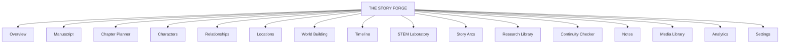

Each module is accessible from the sidebar.

The interface supports responsive navigation, collapsing the sidebar on smaller screens and adapting content layouts to mobile devices.

---

# 4. Technology Stack

The application uses a modern React-based frontend architecture.

## 4.1 Core technologies

| Technology | Responsibility |
|---|---|
| Next.js | Application framework and routing |
| React | Component rendering and UI state |
| TypeScript | Type safety and data modeling |
| Tailwind CSS | Utility-first styling |
| shadcn/ui | Reusable interface components |
| Lucide | Interface iconography |
| Recharts | Data visualization |
| Browser localStorage | Local persistence |
| Mermaid | Technical documentation diagrams |

## 4.2 Next.js

Next.js provides the application foundation.

The App Router organizes routes and supports modular page development.

Benefits include:

- Structured routing.
- Reusable layouts.
- Component-based development.
- Flexible rendering strategies.
- Future API route integration.
- Production deployment support.

## 4.3 React

React powers interactive application components.

Examples include:

- Chapter editor.
- Character detail panels.
- Relationship visualization.
- Timeline filters.
- Search interface.
- Modals.
- Settings.
- Dashboard charts.

## 4.4 TypeScript

TypeScript provides structured definitions for application entities.

This reduces inconsistent data structures and makes future expansion easier.

Major entities include:

- Project.
- Chapter.
- Character.
- Relationship.
- Location.
- TimelineEvent.
- StoryArc.
- StemConcept.
- ResearchEntry.
- ContinuityIssue.
- Note.
- MediaAsset.

## 4.5 Tailwind CSS and shadcn/ui

Tailwind CSS manages the design system.

shadcn/ui provides reusable interface primitives such as:

- Buttons.
- Dialogs.
- Dropdown menus.
- Tables.
- Tabs.
- Cards.
- Inputs.
- Select menus.
- Tooltips.
- Popovers.
- Toast notifications.

The components are styled consistently to maintain a cohesive application experience.

---

# 5. System Architecture

## 5.1 High-level architecture

The current implementation uses a browser-centric architecture.

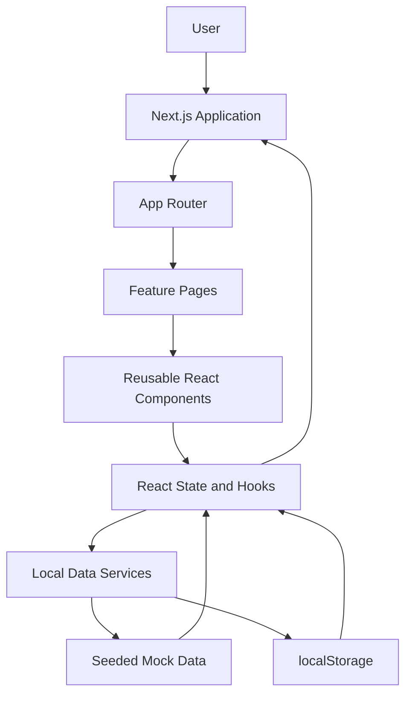

## 5.2 Architectural layers

### Presentation layer

Responsible for rendering:

- Navigation.
- Dashboards.
- Forms.
- Editors.
- Tables.
- Cards.
- Graphs.
- Modals.
- Detail panels.

### Application layer

Responsible for:

- User interactions.
- Form submissions.
- Search.
- Filtering.
- Sorting.
- Validation.
- Navigation.
- UI state.

### Data-access layer

Responsible for:

- Reading records.
- Creating records.
- Updating records.
- Deleting records.
- Persisting changes.
- Restoring initial demo data.

### Persistence layer

Uses browser localStorage.

It stores application changes between sessions in the same browser profile.

### Seed-data layer

Provides initial project content.

It includes realistic characters, chapters, locations, events, story arcs, research entries, and continuity issues.

## 5.3 Data flow

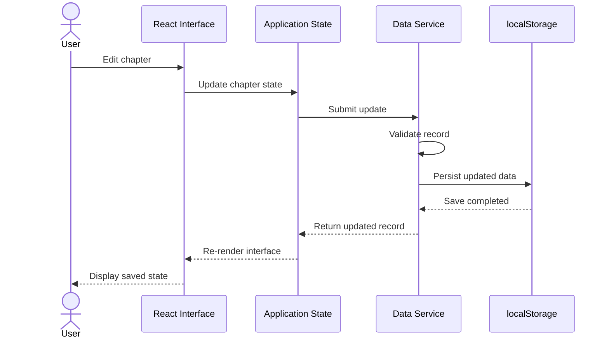

The interface should provide visible feedback when data has been saved.

---

# 6. Application Architecture

## 6.1 Routing architecture

The application uses Next.js App Router conventions.

Representative route structure:

| Route | Page |
|---|---|
| `/` | Overview |
| `/manuscript` | Manuscript editor |
| `/chapters` | Chapter planner |
| `/characters` | Character database |
| `/relationships` | Relationship map |
| `/locations` | Locations |
| `/worldbuilding` | World-building library |
| `/timeline` | Timeline |
| `/stem` | STEM laboratory |
| `/story-arcs` | Story arcs |
| `/research` | Research library |
| `/continuity` | Continuity checker |
| `/notes` | Notes |
| `/media` | Media library |
| `/analytics` | Analytics |
| `/settings` | Settings |

## 6.2 Shared application shell

The shared layout contains:

- Sidebar.
- Header.
- Breadcrumb navigation.
- Global search.
- Quick-create menu.
- Theme controls.
- Notification interface.
- Responsive content area.

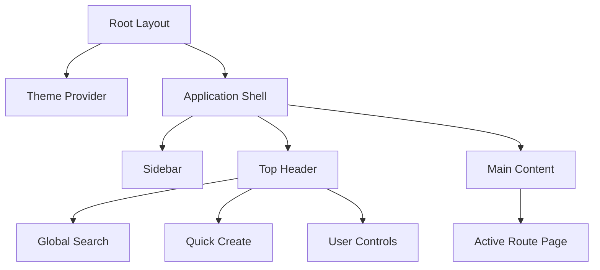

## 6.3 Reusable component architecture

Reusable components reduce duplication.

Examples:

- `AppSidebar`
- `AppHeader`
- `PageHeader`
- `StatCard`
- `SearchInput`
- `FilterBar`
- `DataTable`
- `StatusBadge`
- `ConfirmDialog`
- `CreateEntityDialog`
- `EmptyState`
- `ProgressIndicator`
- `ChartCard`
- `ChapterCard`
- `CharacterCard`
- `DetailPanel`

Feature-specific components should remain inside their respective feature directories where practical.

---

# 7. Directory Structure

The project follows a modular organization.

```text
the-story-forge/
│
├── public/
│   ├── favicon.ico
│   └── assets/
│
├── src/
│   │
│   ├── app/
│   │   ├── layout.tsx
│   │   ├── page.tsx
│   │   ├── globals.css
│   │   │
│   │   ├── manuscript/
│   │   ├── chapters/
│   │   ├── characters/
│   │   ├── relationships/
│   │   ├── locations/
│   │   ├── worldbuilding/
│   │   ├── timeline/
│   │   ├── stem/
│   │   ├── story-arcs/
│   │   ├── research/
│   │   ├── continuity/
│   │   ├── notes/
│   │   ├── media/
│   │   ├── analytics/
│   │   └── settings/
│   │
│   ├── components/
│   │   ├── layout/
│   │   ├── dashboard/
│   │   ├── manuscript/
│   │   ├── chapters/
│   │   ├── characters/
│   │   ├── relationships/
│   │   ├── locations/
│   │   ├── timeline/
│   │   ├── stem/
│   │   ├── continuity/
│   │   ├── charts/
│   │   ├── modals/
│   │   └── ui/
│   │
│   ├── lib/
│   │   ├── mock-data/
│   │   ├── storage/
│   │   ├── utils/
│   │   └── validation/
│   │
│   ├── hooks/
│   │
│   └── types/
│       ├── project.ts
│       ├── chapter.ts
│       ├── character.ts
│       ├── location.ts
│       ├── relationship.ts
│       ├── timeline.ts
│       ├── stem.ts
│       ├── continuity.ts
│       └── research.ts
│
├── README.md
├── package.json
├── tsconfig.json
├── next.config.ts
├── tailwind.config.ts
└── .gitignore
```

The structure separates routing, presentation, domain types, mock data, and persistence utilities.

---

# 8. Data Architecture

The application manages several connected entity types.

## 8.1 Entity relationship overview

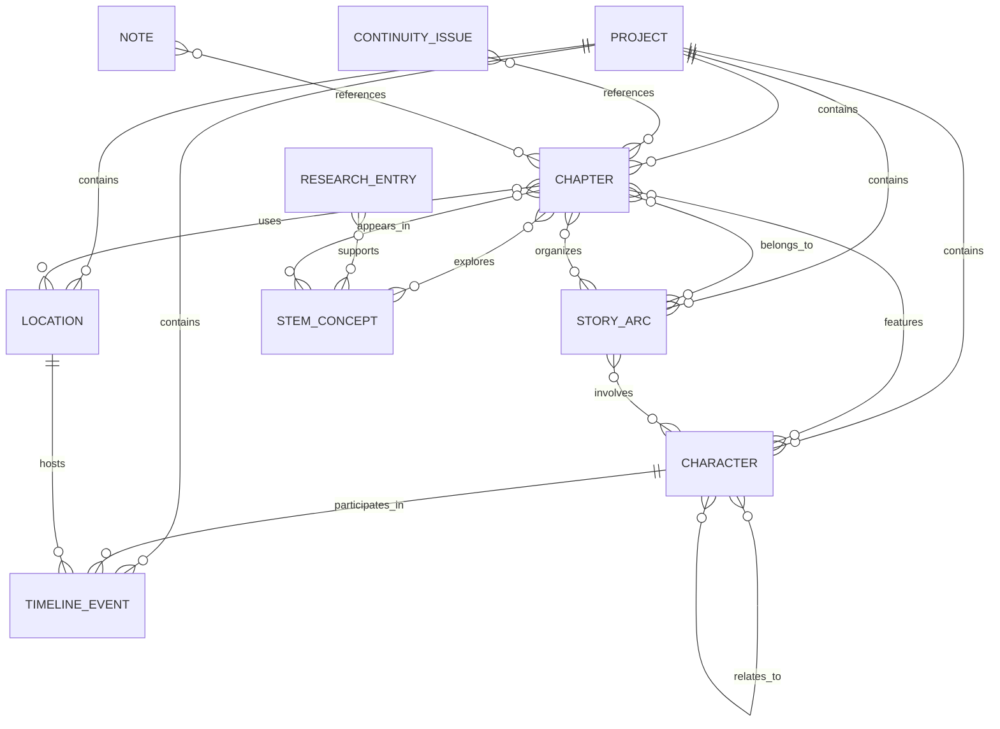

This diagram represents logical relationships, not a claim that a relational database is currently installed.

## 8.2 Project model

```ts
export interface Project {
  id: string;
  title: string;
  subtitle: string;
  description: string;
  genre: string[];
  status: "active" | "paused" | "archived";
  activeTimelineId: string;
  createdAt: string;
  updatedAt: string;
}
```

## 8.3 Chapter model

```ts
export type ChapterStatus =
  | "idea"
  | "outlined"
  | "drafting"
  | "revision"
  | "continuity-review"
  | "complete"
  | "archived";

export interface Chapter {
  id: string;
  number: number;
  title: string;
  partId: string;
  summary: string;
  content: string;
  status: ChapterStatus;
  wordCount: number;
  estimatedPages: number;
  characterIds: string[];
  locationIds: string[];
  storyArcIds: string[];
  stemConceptIds: string[];
  timelineEventIds: string[];
  notes: string[];
  createdAt: string;
  updatedAt: string;
}
```

## 8.4 Character model

```ts
export interface Character {
  id: string;
  name: string;
  species?: string;
  role: string;
  description: string;
  personality: string[];
  strengths: string[];
  weaknesses: string[];
  motivations: string[];
  fears: string[];
  backstory: string;
  characterArc: string;
  status: "active" | "inactive" | "deceased" | "unknown";
  chapterIds: string[];
  relationshipIds: string[];
}
```

## 8.5 Relationship model

```ts
export type RelationshipType =
  | "family"
  | "friendship"
  | "conflict"
  | "caretaking"
  | "rivalry"
  | "attachment"
  | "mentorship"
  | "fear"
  | "trust";

export interface Relationship {
  id: string;
  sourceCharacterId: string;
  targetCharacterId: string;
  type: RelationshipType;
  description: string;
  strength?: number;
  chapterIds: string[];
}
```

## 8.6 Timeline event model

```ts
export interface TimelineEvent {
  id: string;
  title: string;
  description: string;
  eraId: string;
  sequence: number;
  characterIds: string[];
  locationIds: string[];
  chapterIds: string[];
  timelineType: "main" | "flashback" | "future" | "alternate";
}
```

## 8.7 STEM concept model

```ts
export interface StemConcept {
  id: string;
  title: string;
  field: string;
  explanation: string;
  realWorldPrinciple: string;
  narrativeApplication: string;
  chapterIds: string[];
  locationIds: string[];
  accuracyRating: number;
  researchStatus:
    | "not-researched"
    | "researching"
    | "needs-verification"
    | "verified";
}
```

## 8.8 Continuity issue model

```ts
export interface ContinuityIssue {
  id: string;
  title: string;
  description: string;
  category: string;
  severity: "low" | "medium" | "high";
  status: "open" | "in-progress" | "resolved";
  chapterIds: string[];
  resolutionNotes?: string;
  createdAt: string;
  updatedAt: string;
}
```

---

# 9. Mock Data and Persistence

## 9.1 Seeded mock data

The application starts with an initialized project.

The initial project includes:

- 270 planned chapters.
- 34 character records.
- 18 locations.
- 12 story arcs.
- Multiple timeline eras.
- STEM concept records.
- Research records.
- Continuity issues.
- Creative notes.
- Media references.

These values are initial demonstration data and may change as users create, edit, or delete records.

## 9.2 Persistence strategy

The current implementation uses browser localStorage.

The application stores structured data under versioned keys.

Example:

```ts
const STORAGE_KEYS = {
  project: "story-forge:project:v1",
  chapters: "story-forge:chapters:v1",
  characters: "story-forge:characters:v1",
  relationships: "story-forge:relationships:v1",
  locations: "story-forge:locations:v1",
  timeline: "story-forge:timeline:v1",
  stem: "story-forge:stem:v1",
  storyArcs: "story-forge:story-arcs:v1",
  research: "story-forge:research:v1",
  continuity: "story-forge:continuity:v1",
  notes: "story-forge:notes:v1",
  settings: "story-forge:settings:v1"
};
```

## 9.3 Persistence lifecycle

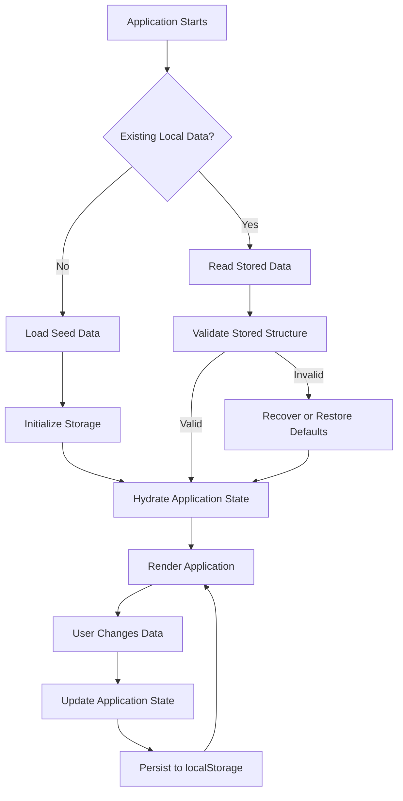

## 9.4 Persistence considerations

localStorage is appropriate for a local prototype and lightweight single-user usage.

It is not a replacement for a production database.

Limitations include:

- Browser-specific storage.
- Limited storage capacity.
- No automatic cloud backup.
- No built-in multi-user synchronization.
- No cross-device synchronization.
- Data can be lost if browser storage is cleared.

For long manuscripts, the application should support frequent JSON exports.

## 9.5 Data recovery

The application includes:

- Initial seed data.
- Reset-demo-data functionality.
- JSON export.
- JSON import.
- Validation of imported structures.
- Safe fallback behaviour for invalid stored data.

---

# 10. Manuscript Management

The manuscript module is the central writing environment.

## 10.1 Organization

Manuscripts are organized into parts and chapters.

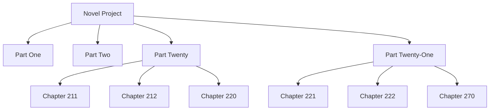

## 10.2 Writing workflow

Each chapter follows a configurable editorial workflow:

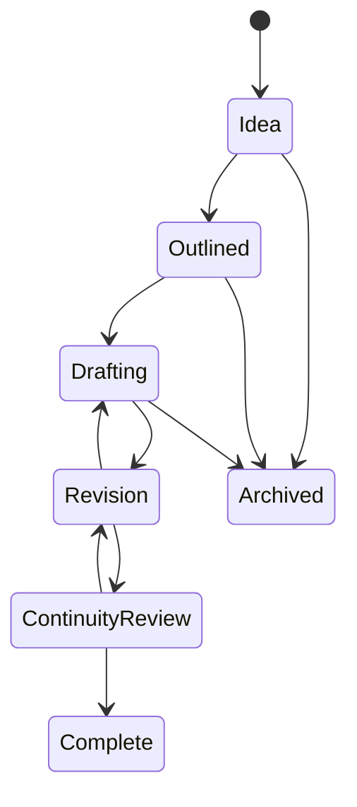

## 10.3 Chapter editor functionality

The editor supports:

- Chapter creation.
- Chapter editing.
- Chapter duplication.
- Chapter deletion.
- Chapter archiving.
- Content editing.
- Metadata editing.
- Status updates.
- Word count.
- Estimated page count.
- Character references.
- Location references.
- Story arc references.
- STEM concept references.
- Notes.

## 10.4 Word count and page estimation

Word count is derived from chapter content.

Page estimation is a configurable approximation.

For example:

```ts
export function estimatePages(
  wordCount: number,
  wordsPerPage = 300
): number {
  return Math.ceil(wordCount / wordsPerPage);
}
```

The estimate is not a substitute for actual typesetting.

Page count depends on:

- Font.
- Font size.
- Page dimensions.
- Margins.
- Line spacing.
- Paragraph spacing.
- Dialogue formatting.

## 10.5 Autosave

The editor updates application state and persists changes through the storage service.

A visible save indicator communicates whether content is:

- Saving.
- Saved.
- Unsaved.
- Unable to save.

---

# 11. Character and Relationship Management

## 11.1 Character profiles

The character database stores structured information.

Each profile includes:

- Identity.
- Role.
- Description.
- Personality.
- Backstory.
- Motivations.
- Fears.
- Strengths.
- Weaknesses.
- Character arc.
- Associated chapters.
- Relationships.

## 11.2 Primary characters

The initial dataset includes:

| Character | Role |
|---|---|
| Punch | Protagonist |
| Ora | Emotional anchor |
| Kuro | Antagonist |
| Sato | Caretaker |
| Haruto | Engineering and conservation connection |
| Dr. Arai | Animal behaviour specialist |
| Dr. Mori | Researcher |
| Nakamura | Zoo staff |
| Toma | Future companion |
| Hana | Potential social connection |
| Nami | Potential social connection |
| Saki | Supporting character |

## 11.3 Relationship graph

The relationship module visualizes connections between characters.

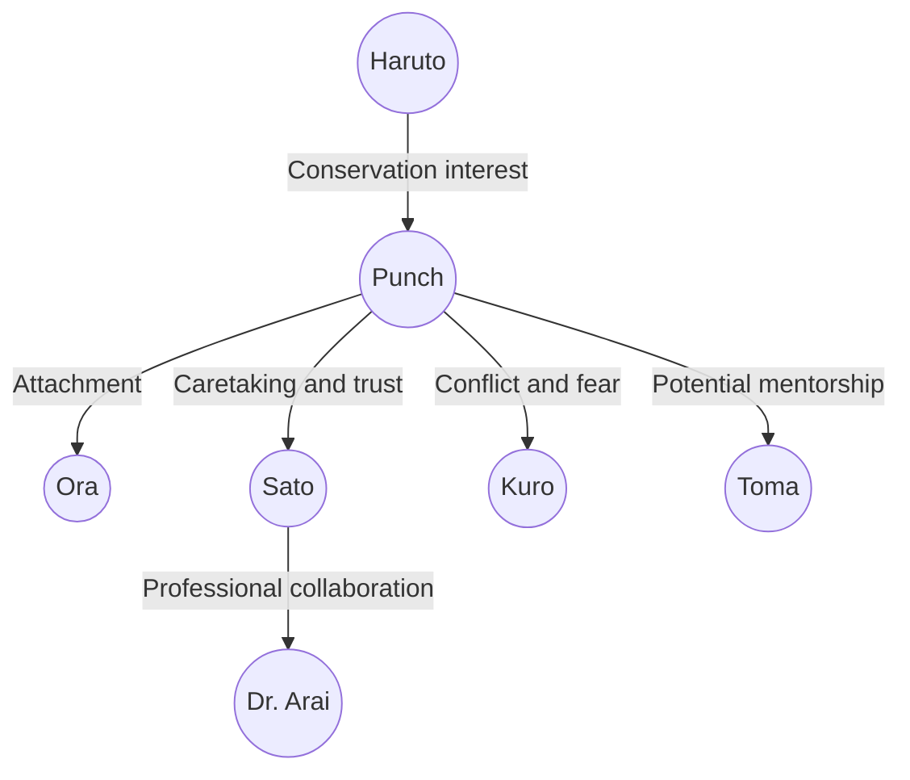

Relationships are stored independently from character profiles.

This allows relationship types and descriptions to be updated without duplicating character information.

---

# 12. Timeline and Story Arc Management

## 12.1 Timeline management

The timeline module separates manuscript order from fictional chronology.

This is essential for projects involving:

- Flashbacks.
- Future events.
- Alternate timelines.
- Multiple points of view.
- Events occurring simultaneously.

The active timeline is:

**The Concrete Jungle — Post-Escape Timeline.**

## 12.2 Story chronology

The current narrative structure is divided into major eras.

| Era | Description |
|---|---|
| Infancy | Punch is born and rejected |
| Early Development | Sato raises Punch and introduces Ora |
| Monkey Mountain | Punch experiences social hierarchy and rejection |
| Habitat Changes | The zoo attempts environmental improvements |
| Storm and Escape | Punch escapes the enclosure |
| Concrete Jungle | Punch navigates urban Tokyo |
| Beyond the City | Punch encounters woodland and other macaques |

## 12.3 Timeline conflict management

Timeline events can be associated with chapters and characters.

The continuity system can flag conflicts involving:

- Impossible event ordering.
- Contradictory character locations.
- Unclear character status.
- Conflicting object ownership.
- Inconsistent timeline assignments.

## 12.4 Story arcs

Each arc tracks:

- Title.
- Description.
- Central conflict.
- Beginning.
- Middle.
- Ending.
- Characters.
- Chapters.
- Themes.
- Status.
- Completion.

Initial story arcs include:

1. The Abandoned Infant.
2. The Gift of Ora.
3. The Curious Young Monkey.
4. The Return to Monkey Mountain.
5. The Rise of Kuro.
6. The Rejected Outsider.
7. The Broken Kingdom.
8. The Great Escape.
9. The Concrete Jungle.
10. The Ghost Hunt.
11. The Sato Confrontation.
12. Beyond the Concrete.
13. The New Troop.
14. The Legacy of Punch.

---

# 13. STEM Laboratory

The STEM Laboratory is a specialized feature of THE STORY FORGE.

Its purpose is to organize scientific concepts used throughout the novel.

Punch learns by observing and interacting with his environment.

The application helps the author connect these experiences to real scientific principles.

## 13.1 Scientific categories

The system supports:

- Physics.
- Mathematics.
- Mechanical engineering.
- Civil engineering.
- Materials science.
- Biology.
- Ecology.
- Chemistry.
- Computer science.
- Environmental engineering.
- Acoustics.
- Optics.
- Fluid dynamics.
- Robotics.
- Systems thinking.

## 13.2 Concept workflow

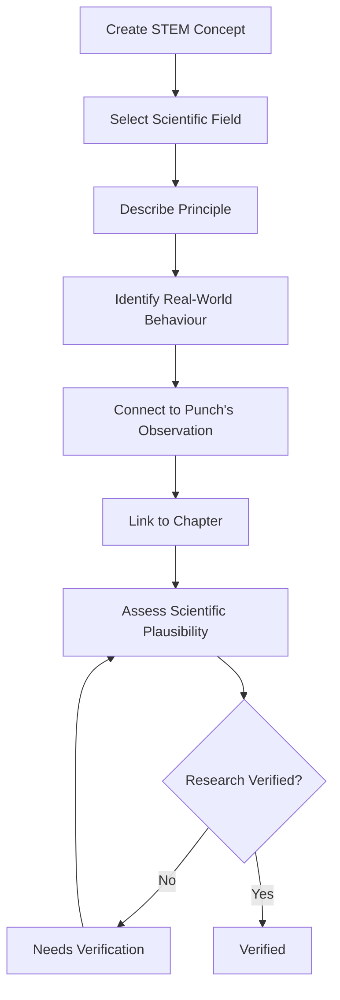

## 13.3 Example: Spatial memory

Scientific field: Cognitive science.

Real-world principle:

Animals can learn and remember spatial relationships between landmarks and locations.

Narrative application:

Punch develops an internal map of Tokyo by observing landmarks, sounds, routes, and familiar environmental patterns.

Associated chapters:

- Chapter 228 — The Invisible Map.
- Chapter 236 — The Search Grid.
- Chapter 250 — The Map Expands.

## 13.4 Example: Materials science

Scientific field: Materials engineering.

Real-world principle:

Materials exhibit different properties depending on composition, wear, moisture, and structural condition.

Narrative application:

Punch examines Ora's fabric and notices damaged seams, worn material, and differences between intact and weakened sections.

Associated chapters:

- Chapter 224 — Ora's Backpack.
- Chapter 235 — The Last Button Eye.
- Chapter 245 — Ora's Last Repair.

## 13.5 Scientific plausibility

Every STEM concept can receive an accuracy assessment.

This helps distinguish:

- Established scientific principles.
- Simplified explanations.
- Plausible fictional extrapolations.
- Speculative concepts.
- Ideas requiring additional research.

The platform does not claim that Punch literally possesses human scientific understanding.

The author remains responsible for representing animal cognition realistically.

---

# 14. Continuity Management

Continuity management is designed to prevent narrative contradictions.

## 14.1 Issue categories

The system tracks:

- Character ages.
- Character status.
- Character relationships.
- Character locations.
- Object ownership.
- Object condition.
- Event chronology.
- Chapter order.
- Story arc consistency.
- Animal behaviour.
- Scientific plausibility.

## 14.2 Issue severity

| Severity | Meaning |
|---|---|
| Low | Minor inconsistency |
| Medium | Requires editorial attention |
| High | Potentially significant story conflict |

## 14.3 Example issue

**Issue:** Kuro's fate is uncertain.

Severity: High.

Related chapters: 217–220.

Description:

During the collapse of the climbing structure, Kuro becomes trapped or seriously injured.

His ultimate condition has not yet been confirmed.

Resolution required:

The author must establish whether Kuro survived, died, or remains unaccounted for before later chapters depend on his status.

## 14.4 Continuity workflow

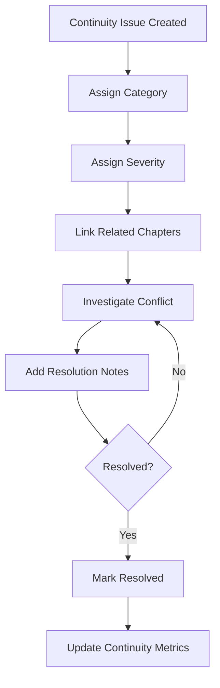

## 14.5 Continuity score

The application can calculate a project-management indicator based on resolved issues.

```ts
function calculateContinuityScore(
  totalIssues: number,
  resolvedIssues: number
): number {
  if (totalIssues === 0) return 100;

  return Math.round(
    (resolvedIssues / totalIssues) * 100
  );
}
```

This score measures issue resolution, not objective narrative quality.

The current implementation uses structured rules and user-managed issues rather than an external AI analysis engine.

---

# 15. Research and World Building

## 15.1 Research library

The research library organizes information that supports the fictional universe.

Research categories include:

- Japanese macaques.
- Animal attachment.
- Zoo animal welfare.
- Urban environments.
- Japanese infrastructure.
- Engineering.
- Animal cognition.
- Environmental science.
- Narrative structure.
- Psychological storytelling.

Each entry includes:

- Title.
- Category.
- Summary.
- Source name.
- Source URL.
- Research date.
- Confidence level.
- Related characters.
- Related chapters.
- Notes.
- Verification status.

## 15.2 Research status

Research entries support:

- Not researched.
- Researching.
- Needs verification.
- Verified.
- Archived.

Mock research records must be identified as demonstration data.

They should not be mistaken for verified scientific sources.

## 15.3 World-building

The world-building module stores reusable information about the fictional universe.

Examples:

- Zoo structure.
- Enclosure design.
- Animal care procedures.
- Japanese urban environments.
- Forest habitats.
- Macaque social behaviour.
- Industrial locations.
- Environmental systems.

World-building records can be associated with chapters, characters, and locations.

---

# 16. Analytics and Visualization

The analytics dashboard provides a high-level view of the project's development.

## 16.1 Metrics

The application tracks:

- Total chapters.
- Completed chapters.
- Chapters in progress.
- Planned manuscript pages.
- Word count.
- Character count.
- Story arc completion.
- Research completion.
- STEM concept coverage.
- Unresolved continuity issues.

## 16.2 Charts

Recharts supports:

1. Chapters by status.
2. Word count by part.
3. Story arc completion.
4. Character appearances by chapter.
5. STEM concept coverage.
6. Continuity issues by severity.
7. Manuscript progress over time.

## 16.3 Analytics data flow

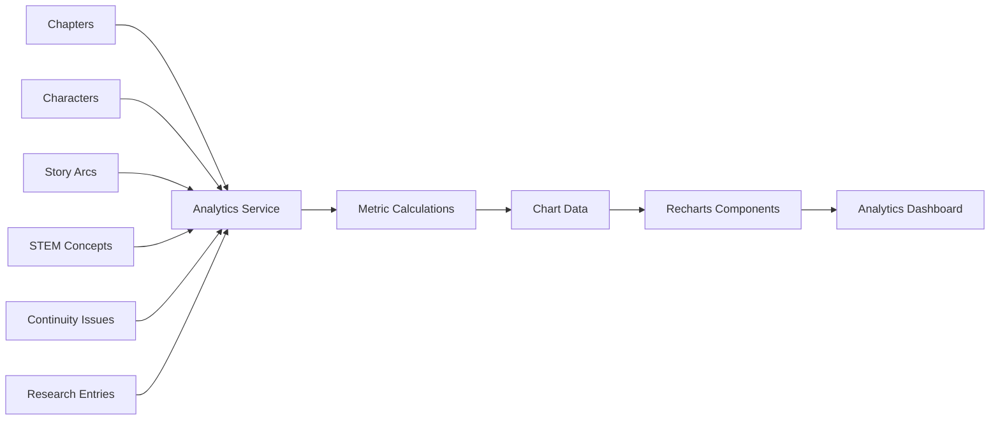

Analytics are derived from application records rather than maintained as unrelated hardcoded statistics.

---

# 17. User Interface and Design System

## 17.1 Design philosophy

The interface uses a dark, forest-inspired visual identity.

It is designed to communicate:

- Mystery.
- Nature.
- Memory.
- Engineering.
- Emotional storytelling.
- Professional organization.

The interface prioritizes readability and information hierarchy.

## 17.2 Color palette

| Token | Hex | Usage |
|---|---|---|
| Deep Charcoal | `#111412` | Primary background |
| Dark Forest | `#18221B` | Sidebar |
| Secondary Panel | `#202923` | Panels |
| Elevated Card | `#28332C` | Cards |
| Moss Green | `#8BAA77` | Primary accent |
| Warm Amber | `#D5A65B` | Secondary accent |
| Muted Orange | `#C77B4A` | Highlights |
| Soft Cream | `#E8E3D7` | Primary text |
| Muted Grey | `#929A91` | Secondary text |

## 17.3 Themes

The application supports:

- Dark theme.
- Light theme.

Theme selection is persisted locally.

## 17.4 Responsive behaviour

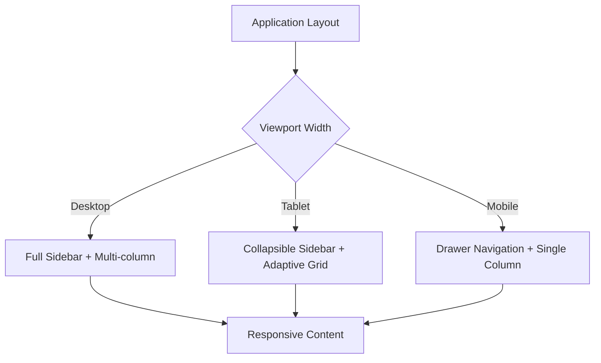

The interface adapts:

- Navigation.
- Tables.
- Forms.
- Cards.
- Writing panels.
- Dialogs.
- Charts.

---

# 18. Installation and Development

## 18.1 Requirements

Install the following:

- Node.js 20 or later.
- npm, pnpm, or yarn.
- Git.
- A modern web browser.

## 18.2 Clone the repository

```bash
git clone https://github.com/YOUR_USERNAME/the-story-forge.git

cd the-story-forge
```

Replace `YOUR_USERNAME` with the actual GitHub account or organization.

## 18.3 Install dependencies

Using npm:

```bash
npm install
```

Using pnpm:

```bash
pnpm install
```

Using yarn:

```bash
yarn install
```

## 18.4 Run the development server

```bash
npm run dev
```

Open:

```text
http://localhost:3000
```

## 18.5 Production build

```bash
npm run build
```

## 18.6 Start production server

```bash
npm run start
```

## 18.7 Lint

```bash
npm run lint
```

The exact scripts should match the repository's package configuration.

## 18.8 Environment variables

The current mock-data version does not require API credentials.

A typical `.env.example` can remain minimal:

```env
# THE STORY FORGE
# Local mock-data configuration

NEXT_PUBLIC_APP_NAME=THE STORY FORGE
NEXT_PUBLIC_APP_MODE=demo
```

Do not place private credentials in client-side environment variables.

---

# 19. Testing and Quality Assurance

The application should be validated across functionality, data integrity, responsiveness, and accessibility.

## 19.1 Functional testing

Test the following:

| Feature | Expected result |
|---|---|
| Navigation | All routes load |
| Chapter creation | New chapter appears |
| Chapter editing | Changes persist |
| Chapter deletion | Confirmation is required |
| Character creation | Profile is saved |
| Relationship creation | Graph updates |
| Location creation | Location appears in library |
| Timeline filtering | Events update |
| STEM creation | Concept is saved |
| Story arc editing | Changes persist |
| Research creation | Entry appears |
| Continuity resolution | Issue status updates |
| Notes | Create, edit, delete |
| Search | Results are relevant |
| Theme switching | Theme changes |
| Export | JSON file downloads |
| Import | Valid JSON is accepted |
| Reset | Demo data is restored |

## 19.2 Data integrity testing

Verify:

- Stable IDs are maintained.
- Related records reference valid entities.
- Deleted records do not leave unintended broken references.
- Imported data is validated.
- Invalid storage data is handled gracefully.
- Seed data remains unchanged when users edit working copies.

## 19.3 Responsive testing

Test:

- Desktop widths.
- Tablet widths.
- Mobile widths.
- Landscape mobile.
- Small-screen navigation.
- Modal sizing.
- Table overflow.
- Editor usability.

## 19.4 Accessibility testing

Validate:

- Keyboard navigation.
- Focus visibility.
- Semantic HTML.
- Dialog focus management.
- Accessible labels.
- Colour contrast.
- Form error messages.
- Screen-reader status announcements.

## 19.5 Suggested future automated test stack

For expanded test coverage, consider:

- Vitest for unit testing.
- React Testing Library for component tests.
- Playwright for end-to-end testing.
- axe-core for accessibility checks.

Example test command structure:

```bash
npm run test
npm run test:e2e
```

These commands should be added to the repository when the corresponding test suites are configured.

---

# 20. Data Import, Export, Security, and Deployment

## 20.1 JSON export

The application supports exporting project records into JSON.

Example project structure:

```json
{
  "version": 1,
  "project": {
    "id": "project-story-forge",
    "title": "The Stuffed God of Monkey Mountain",
    "status": "active"
  },
  "chapters": [],
  "characters": [],
  "relationships": [],
  "locations": [],
  "timelineEvents": [],
  "storyArcs": [],
  "stemConcepts": [],
  "researchEntries": [],
  "continuityIssues": [],
  "notes": []
}
```

This is a simplified export example.

The actual export should include all supported records and settings.

## 20.2 Import validation

Imported JSON should be checked for:

- Valid JSON syntax.
- Supported schema version.
- Required fields.
- Valid record identifiers.
- Valid entity types.
- Valid relationship references.
- Valid array structures.

Invalid files should be rejected with an understandable error.

Import should not silently overwrite existing data without user confirmation.

## 20.3 Data flow for import and export

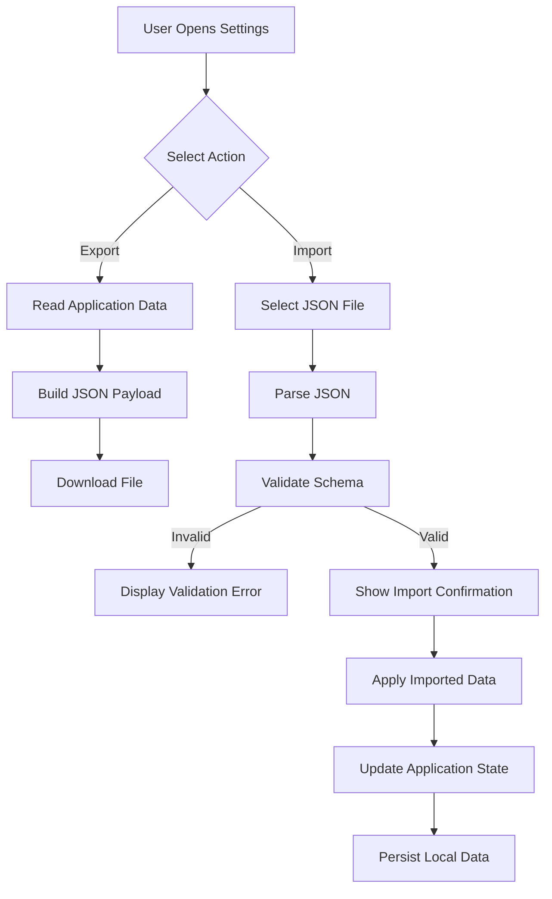

## 20.4 Security considerations

Although the current implementation is frontend-focused, security remains important.

Recommended practices:

- Validate all imported data.
- Avoid rendering untrusted HTML.
- Sanitize user-generated rich content where applicable.
- Avoid unsafe use of `dangerouslySetInnerHTML`.
- Avoid embedding secrets in frontend code.
- Use secure dependency versions.
- Keep project data private within the user's browser profile.
- Confirm destructive actions.
- Handle malformed localStorage values safely.

localStorage is not encrypted storage.

Anyone with access to the browser profile or developer tools may be able to inspect stored content.

Sensitive manuscript material should not be treated as protected merely because it is stored locally.

## 20.5 Deployment architecture

The application can be deployed to Vercel.

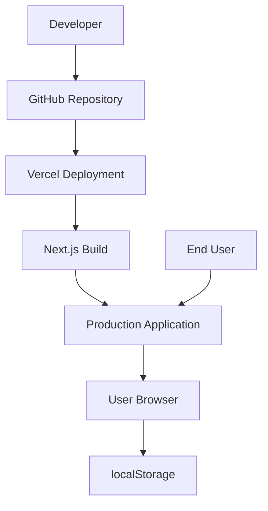

## 20.6 Deployment steps

1. Push the repository to GitHub.
2. Sign in to Vercel.
3. Import the GitHub repository.
4. Select the Next.js framework preset.
5. Confirm build configuration.
6. Deploy.
7. Verify the production URL.
8. Test local persistence and data export.

No external database configuration is necessary for the mock-data version.

## 20.7 Deployment limitations

Because data is stored in localStorage:

- Data is not synchronized between devices.
- Different browsers have separate data.
- Clearing browser storage can remove project changes.
- Users do not share a central project workspace.
- There is no automatic server-side backup.

A production version intended for multiple users should introduce authenticated server-side persistence.

---

# 21. Future Development

THE STORY FORGE is designed with future expansion in mind.

The current application provides a functional local prototype. The following capabilities are natural future extensions.

## 21.1 Database integration

Potential future stack:

- PostgreSQL.
- Supabase.
- Prisma or Drizzle ORM.

A database would support:

- Cloud persistence.
- Cross-device synchronization.
- Larger datasets.
- User accounts.
- Collaborative access.

## 21.2 Authentication

Possible features:

- Email and password login.
- OAuth.
- User profiles.
- Private projects.
- Shared workspaces.
- Project permissions.

## 21.3 AI-assisted writing

Possible integrations:

- Chapter summarization.
- Character consistency suggestions.
- Timeline conflict detection.
- Dialogue review.
- Scientific plausibility assistance.
- Story arc analysis.
- Writing suggestions.
- Outline generation.

AI-generated suggestions should remain optional and subject to author approval.

## 21.4 Advanced continuity analysis

Future continuity capabilities could analyze:

- Character location across chapters.
- Object ownership.
- Character ages.
- Event order.
- Physical descriptions.
- Relationship changes.
- Timeline contradictions.

This could be implemented using structured rules, language models, or a hybrid approach.

## 21.5 Collaboration

Potential features:

- Multiple authors.
- Comments.
- Editorial review.
- Revision history.
- Shared character databases.
- Collaborative story planning.

## 21.6 Version control for manuscripts

Potential features:

- Chapter snapshots.
- Version comparison.
- Restore previous versions.
- Revision history.
- Change attribution.
- Draft branching.

## 21.7 Advanced publishing

Possible export formats:

- Markdown.
- DOCX.
- PDF.
- EPUB.
- Screenplay format.
- Print-ready manuscript.

## 21.8 Backup and synchronization

Potential future improvements:

- Automatic cloud backups.
- Versioned project snapshots.
- Scheduled exports.
- Cross-device synchronization.
- Conflict resolution.

---

# 22. Contributing

Contributions are welcome.

Potential areas include:

- UI improvements.
- Accessibility.
- Data-model improvements.
- Performance optimization.
- Documentation.
- Testing.
- Timeline visualization.
- Relationship mapping.
- Manuscript editing tools.
- Scientific reference organization.

## 22.1 Suggested workflow

1. Fork the repository.
2. Create a feature branch.
3. Implement the change.
4. Test the feature.
5. Update documentation.
6. Submit a pull request.

Example:

```bash
git checkout -b feature/advanced-timeline
```

Commit changes:

```bash
git add .
git commit -m "Add advanced timeline filtering"
```

Push:

```bash
git push origin feature/advanced-timeline
```

## 22.2 Contribution principles

- Preserve TypeScript type safety.
- Use reusable components.
- Follow the existing design system.
- Avoid unnecessary dependencies.
- Maintain responsive behaviour.
- Preserve mock-data compatibility.
- Avoid breaking existing local storage structures.
- Document significant architectural changes.

---

# 23. License

This repository can use the MIT License.

Add a `LICENSE` file to the root directory containing the standard MIT license text, with the appropriate copyright holder and year.

The fictional story, characters, world-building, and original narrative material associated with *The Stuffed God of Monkey Mountain* remain subject to their respective copyright ownership.

The software license does not automatically grant rights to reuse the underlying fictional manuscript or its creative assets.

---

# Appendix A — Application Module Map

```mermaid
flowchart TB
    APP[THE STORY FORGE]

    APP --> CORE[Creative Core]
    APP --> WORLD[World Management]
    APP --> SCIENCE[Research and STEM]
    APP --> QA[Quality and Continuity]
    APP --> REPORTS[Analytics]
    APP --> SYSTEM[System Settings]

    CORE --> MANUSCRIPT[Manuscript]
    CORE --> CHAPTERS[Chapter Planner]
    CORE --> ARCS[Story Arcs]
    CORE --> NOTES[Notes]

    WORLD --> CHARACTERS[Characters]
    WORLD --> RELATIONSHIPS[Relationships]
    WORLD --> LOCATIONS[Locations]
    WORLD --> WORLDBUILDING[World Building]
    WORLD --> TIMELINE[Timeline]

    SCIENCE --> STEM[STEM Laboratory]
    SCIENCE --> RESEARCH[Research Library]
    SCIENCE --> MEDIA[Media Library]

    QA --> CONTINUITY[Continuity Checker]

    REPORTS --> ANALYTICS[Analytics Dashboard]

    SYSTEM --> SETTINGS[Settings]
    SYSTEM --> STORAGE[Local Persistence]
    SYSTEM --> EXPORT[Import and Export]
```

# Appendix B — Example User Journey

The following workflow demonstrates how an author might use the application to develop a new chapter.

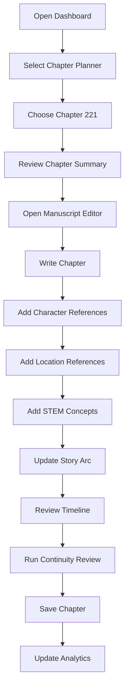

# Appendix C — Example Narrative Data Flow

A chapter is not an isolated document.

It can be connected to multiple project resources.

Example:

**Chapter 228 — The Invisible Map**

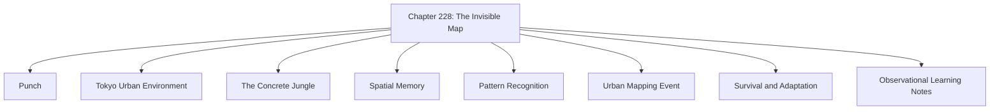

This connected structure makes it easier to understand why a chapter exists within the larger story.

# Appendix D — Current Project Continuity Reference

The default active narrative begins immediately after Chapter 220.

## Current story position

**Part Twenty — The Night of the Broken Kingdom**

Chapter 220 ends with Punch escaping into the city.

## Current active timeline

**Part Twenty-One — The Concrete Jungle**

Planned chapters:

221–270.

## Critical continuity facts

| Element | Current state |
|---|---|
| Punch | Escaped and alive |
| Ora | With Punch |
| Sato | Searching for Punch |
| Kuro | Fate uncertain |
| Monkey Mountain | Damaged by storm |
| Zoo staff | Investigating the escape |
| Punch's location | Tokyo urban environment |
| Active story arc | The Concrete Jungle |

## Important narrative constraints

1. Do not assume Kuro is dead.
2. Do not assume Punch has returned to the forest.
3. Do not treat future events as completed.
4. Preserve Ora's physical condition across chapters.
5. Keep Punch's intelligence grounded in observation and animal cognition.
6. Distinguish between the manuscript's active timeline and alternate story ideas.
7. Preserve the emotional significance of Punch and Sato's relationship.

---

# Appendix E — Product Summary

THE STORY FORGE transforms a large fictional manuscript into a structured, interconnected creative workspace.

It provides:

- A manuscript management system.
- A chapter planning environment.
- A character database.
- A relationship visualization tool.
- A location and world-building library.
- A chronological timeline.
- A STEM research laboratory.
- A story arc manager.
- A research library.
- A continuity tracking system.
- A notes workspace.
- A media reference library.
- A project analytics dashboard.
- Local data persistence.
- JSON import and export.
- Responsive desktop and mobile interfaces.

The application is designed to help authors manage the complexity of large fictional universes while keeping the creative process organized and accessible.

**THE STORY FORGE**

*Every character has a history. Every event has a place. Every detail has a purpose.*

**Build the world. Protect the continuity. Tell the story.**
